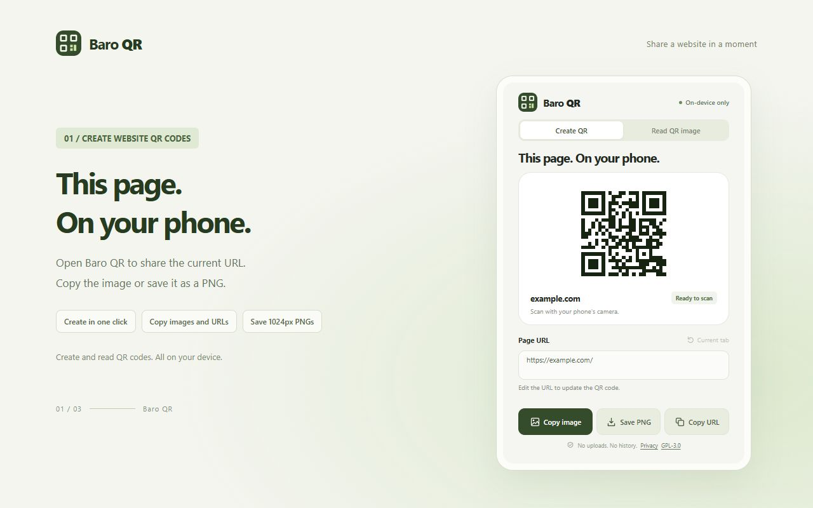

# Baro QR

[한국어](https://github.com/LUNA12379/baro-qr-extension#readme) · **English**

Turn the current website or any link into a QR code, and read QR codes from images. A free, open-source extension for desktop Chrome and Edge on Windows and macOS.

[Install from the Chrome Web Store](https://chromewebstore.google.com/detail/geiejbjijpfomnicppkbiephpnnnobej) · [Download ZIP for manual installation](https://github.com/LUNA12379/baro-qr-extension/releases/latest/download/BaroQR.zip) · [Releases](https://github.com/LUNA12379/baro-qr-extension/releases)

Generate QR codes, copy images or URLs, save 1024 × 1024 PNG files, create QR codes from the link context menu, and read QR images. URLs and images are processed on your device.



## Install

### Chrome Web Store (recommended)

1. Open the [Baro QR store page](https://chromewebstore.google.com/detail/geiejbjijpfomnicppkbiephpnnnobej) in Chrome.
2. Click **Add to Chrome → Add extension**.
3. Click the **puzzle-shaped Extensions icon** at the top right of the browser, then click the **pin** beside **Baro QR**.
4. Open a website and click the **Baro QR toolbar icon**.

Chrome automatically updates the store version when an approved update is published.

### Switch from an unpacked installation

An extension installed manually from a ZIP does not switch to the store version automatically. At `chrome://extensions`, disable or remove the existing Baro QR installation, then install it from the store. Keeping both enabled can create duplicate icons and context menu entries.

### Manual ZIP installation

1. Download `BaroQR.zip` from the [latest release](https://github.com/LUNA12379/baro-qr-extension/releases/latest) and extract it.
2. Open `chrome://extensions` in Chrome or `edge://extensions` in Edge.
3. Enable **Developer mode**.
4. Click **Load unpacked**.
5. Select the folder containing `manifest.json`. In this source repository, select the `extension` folder.
6. Pin Baro QR using the browser's Extensions menu.

Keep the extracted folder in place. Moving or deleting it will stop the extension from working. Manual installations do not update automatically: replace the files with the latest ZIP contents, then click **Reload** on the extension management page.

If you use GitHub's **Code → Download ZIP**, select the `extension` folder inside the extracted project. Built files are included, so no build step is required.

## Use

### Language

Version 1.2.0 adds English and Korean throughout the interface, context menu, and feedback messages. The extension follows your browser's display language, using Korean for Korean browsers and English for other languages. Store installations receive this feature once version 1.2.0 is approved and published.

### Create a QR code

- Click the extension icon to create a QR code for the current page.
- Edit the URL to update the code, or choose **Current tab** to restore the original page URL.
- Use **Copy image** to paste the QR code into a chat or document.
- Use **Save PNG** to download a 1024 × 1024 image with a white border.
- Use **Copy URL** to copy the website address.
- Right-click an HTTP/HTTPS link and select **Create QR code with Baro QR** to open its QR code in a separate window without visiting the link.

QR generation supports HTTP and HTTPS website URLs up to 2,300 UTF-8 bytes. Internal browser pages and other URL schemes are not supported. You can enter a website URL manually when the current tab is unavailable.

### Read a QR image

1. Open **Read QR image**.
2. Choose or drop an image, or paste an image with **Ctrl+V** on Windows or **⌘V** on macOS.
3. Review the decoded content. Choose **Copy text**, or **Open link** for a supported website URL.

Supported formats: PNG, JPG, WebP, GIF, and BMP, up to 10 MB. One QR code is read per image; GIFs use the first frame. If a code is small or blurry, crop to the QR code and try again. Large images may need to be cropped first.

Decoded links are never opened or executed automatically. Generation and image reading work offline; opening a website requires a network connection. If image copying is unavailable in your browser, use **Save PNG**.

## Privacy and permissions

QR generation and image reading run locally in the browser. No account, advertisements, analytics, remote QR service, or usage history is used.

- **activeTab**: temporarily reads the URL and title of the tab where you invoke the extension.
- **contextMenus**: adds the QR action to the link context menu.
- Images are accessed only when you choose, drop, or paste them.
- Clipboard writes and downloads happen when you use their controls.

See the [Privacy Policy (English)](https://github.com/LUNA12379/baro-qr-extension/blob/main/PRIVACY.md#english).

## Store and updates

Baro QR was first published on the Chrome Web Store on October 29, 2026. [Install from the store](https://chromewebstore.google.com/detail/geiejbjijpfomnicppkbiephpnnnobej) to receive published updates automatically. Uploading a GitHub release alone does not update store installations.

Store listing materials are in [`store/`](https://github.com/LUNA12379/baro-qr-extension/tree/main/store), including the [English description](https://github.com/LUNA12379/baro-qr-extension/blob/main/store/listing-en.md).

## Build from source

Requires Node.js 22 or later:

```sh
npm ci
npm test
npm run build
```

Load the resulting `extension` folder as an unpacked extension. After editing the source, rebuild and reload the extension.

Translations are in `src/locales/en.json` and `src/locales/ko.json`. The build packages them as Chrome message catalogs in `extension/_locales/`.

## License

Copyright (C) 2026 LUNA12379. Licensed under **GPL-3.0-only**. You may use, modify, and redistribute the program, including commercially, under the license terms. Distributing modified versions requires compliance with GPL-3.0, including its source availability and same-license requirements. This program comes with no warranty.

- [Full license](https://github.com/LUNA12379/baro-qr-extension/blob/main/LICENSE)
- [Corresponding source and build instructions](https://github.com/LUNA12379/baro-qr-extension/blob/main/SOURCE.md)
- [Project notices](https://github.com/LUNA12379/baro-qr-extension/blob/main/NOTICE)

Bundled libraries retain their licenses: `qrcode` and `dijkstrajs` use the MIT license; `jsQR` uses Apache-2.0. Their license texts are included in `extension/THIRD_PARTY_NOTICES.txt`.

For support, [open a GitHub issue](https://github.com/LUNA12379/baro-qr-extension/issues) or email **lrw12379@gmail.com**. GitHub issues are public; do not include private URLs, QR codes, or personal information.
